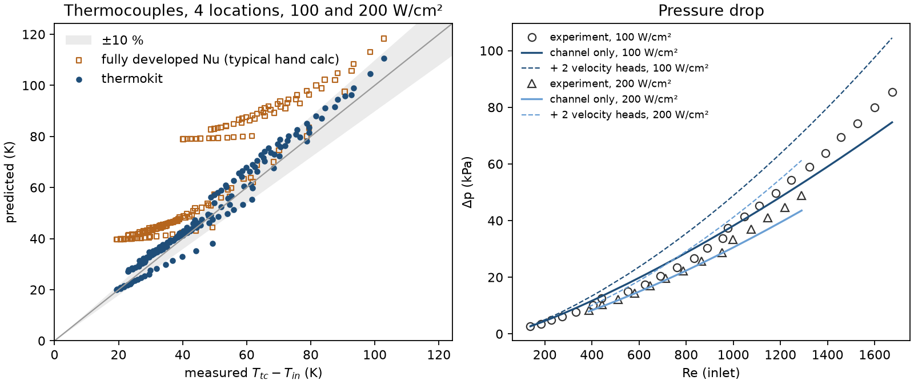
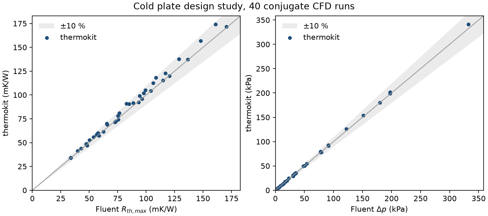
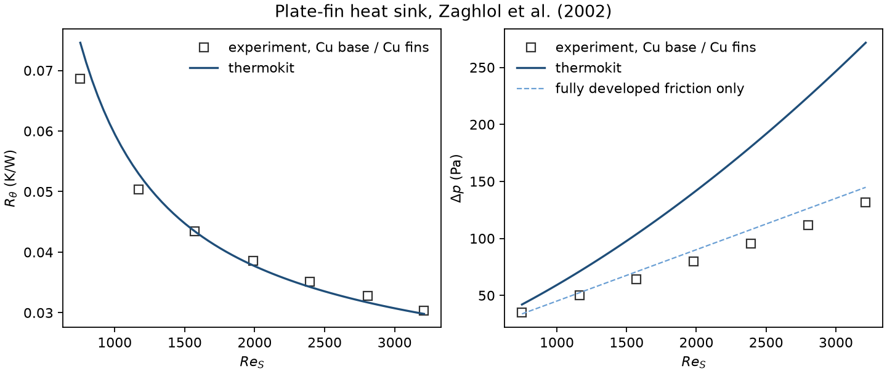

# thermokit

Thermal design calculations for electronics cooling: chip stacks, air-cooled plate-fin heat sinks and liquid cold plates. Each tool answers in about a second, so a design can be sized and traded off before any CFD is set up. The cold plate model is checked against published experiments and 40 conjugate CFD runs.

Live demo: https://thermokit-9pzqpauymjows7w8ddlhzr.streamlit.app/

## What it answers

- **Chip stack.** Junction temperature from θ<sub>jc</sub>, TIM, base and sink, and which layer takes the largest share. Spreading from a small die into a larger base uses the exact series solution, coupled to how well the base is cooled.
- **Air heat sink.** R<sub>sink</sub> and Δp for a shrouded plate-fin sink, the operating point on a real fan curve, natural convection with vertical fins, and a fin-count sweep that finds the optimum.
- **Liquid cold plate.** Peak base temperature, R<sub>th</sub>, Δp and pumping power for straight micro- or mini-channels, with water or glycol. Laminar heat transfer comes from a thermal-entry solution for the actual channel shape, not a single fully developed Nu.

## Validation

| Model | Compared with | Result |
|---|---|---|
| Cold plate, temperatures | Qu & Mudawar (2002) experiments: 156 thermocouple readings, Re = 139 to 1674, q″ = 100 and 200 W/cm<sup>2</sup> | mean error 8.2 % (a fully developed Nu hand calc gives 40.1 %, up to +105 %) |
| Cold plate, pressure drop | Qu & Mudawar (2002), 39 points | channel Δp mean error 8.4 % |
| Cold plate, R<sub>th</sub> and Δp | 40 conjugate CFD runs (Ansys Fluent): copper and silicon, 100 to 350 µm channels, 200 to 1000 ml/min | R<sub>th,max</sub> mean error 3.6 % (worst +10.0 %), Δp 2.1 % (worst +9.0 %) |
| Air heat sink, R<sub>θ</sub> | Zaghlol et al. (2002) experiments, all-copper sink, 585 W, Re<sub>S</sub> = 750 to 3200 | mean error 3.3 % (−3.2 % to +8.7 %) |
| Air heat sink, Δp | Zaghlol et al. (2002), same sink | overpredicts by 19 to 106 %, see Limits |
| Duct solver | Shah & London (1978) | f·Re and fully developed Nu<sub>H1</sub> within 0.3 %, parallel-plate thermal entry within 3 % |
| Spreading resistance | exact half-space limit, 8/(3π<sup>2</sup>ka) | within 0.5 % |

<p align="center"></p>
<p align="center"></p>
<p align="center"></p>

The heat sink data were read from the vector charts in the Zaghlol et al. paper and calibrated on the axis ticks. The Re<sub>S</sub> values match the paper's Table 2 to within ±4.

The CFD runs are from [microchannel-cold-plate-cht](https://github.com/KrishnaChanduri06/microchannel-cold-plate-cht), which also holds the digitised Qu & Mudawar data.

## Quick start

```powershell
python -m venv .venv
.venv\Scripts\pip install -e ".[app,dev]"
.venv\Scripts\streamlit run app/streamlit_app.py
```

```python
from thermokit import ColdPlate

um, mm = 1e-6, 1e-3
plate = ColdPlate(width=10 * mm, length=44.8 * mm, channel_width=100 * um, channel_height=713 * um,
                  fin_width=100 * um, base_thickness=1 * mm, k=390, lid="bonded")
print(plate.solve(flow_lpm=1.0, power=448.0, t_in=30.0).summary())
```

```
50 channels, Re = 1095 (laminar), u = 4.68 m/s
T_out = 36.5 °C, T_base,max = 45.4 °C
R_th = 34.4 mK/W (peak), 26.0 mK/W (mean)
Δp = 201.66 kPa, pumping power = 3.361 W
note: flow is thermally developing over the whole channel
```

More in `examples/`: a CPU stack, fin count against a fan curve, and a channel-width and flow sweep for a 448 W cold plate.

## Models

| | Method | Reference |
|---|---|---|
| Spreading resistance | Fourier–Bessel series, isoflux circular source on a circular plate, film coefficient underneath | Yovanovich, Culham & Teertstra, IEEE Trans. CPMT-A 21(1), 1998 |
| Duct flow | finite volume on the channel cross-section: f·Re, Nu<sub>H1</sub> with any heated walls, thermal entry by marching in x* = x/(D<sub>h</sub>·Re·Pr) | checked against Shah & London, *Laminar Flow Forced Convection in Ducts*, 1978 |
| Heated liquid | Nu ∝ (μ<sub>b</sub>/μ<sub>w</sub>)<sup>0.14</sup>, f ∝ (μ<sub>w</sub>/μ<sub>b</sub>)<sup>0.58</sup> | Deissler, in Kakaç, Shah & Aung, *Handbook of Single-Phase Convective Heat Transfer*, 1987 |
| Developing-flow Δp | Hagenbach K(∞) | Shah & London, 1978 |
| Turbulent and transitional | Gnielinski, linear blend for 2300 < Re < 10<sup>4</sup> | Gnielinski, IJHMT 63, 2013 |
| Heat sink, forced | composite developing and fully developed parallel-plate Nu with fin efficiency | Teertstra, Yovanovich & Culham, SEMI-THERM 15, 1999 |
| Heat sink, Δp | contraction, expansion and apparent friction | Culham & Muzychka, IEEE Trans. CPT 24(2), 2001 |
| Heat sink, natural | symmetric isothermal plates and optimum gap | Bar-Cohen & Rohsenow, J. Heat Transfer 106, 1984 |
| Properties | water, air, ethylene and propylene glycol | CoolProp |

## Limits

- The cold plate base is 1D across its thickness, and axial conduction in the base is not modelled. In the Qu & Mudawar data this shows up as the model reading low near the inlet at low Re.
- Turbulent channel Nu is fully developed, which is conservative for short channels.
- The heat sink model assumes no bypass. With a gap between the fin tips and the duct wall, R will be higher than predicted.
- Heat sink Δp is conservative. On the Zaghlol et al. sink (254 mm long, 2.1 mm gaps) the measured Δp follows fully developed channel friction alone, within 9.4 %. The entrance, developing-flow and contraction terms of the Culham & Muzychka model roughly double the prediction at Re<sub>S</sub> = 3200. Size fans with this in mind, and check Δp on a real sample if the fan margin is tight.
- Natural convection leaves out radiation.
- These are design estimates. Confirm final hardware with CFD or a test.

## Layout

```
src/thermokit/   stack, spreading, duct solver, heat sink, cold plate, fluid properties
app/             Streamlit demo
examples/        worked cases
validation/      comparison scripts, data and figures
tests/           pytest suite
```

## Licence

MIT. Built by Chanduri Sreekrishna Abhay.
